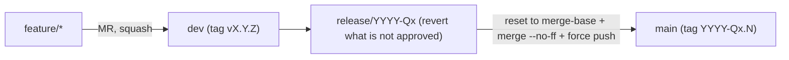

# Workshop `dbt` release flow

## 1. Branching and tagging (Modified GitFlow)

Repo `workshop/dbt-vdp`: `http://localhost/workshop/dbt-vdp.git` from the host, `http://gitlab.local/workshop/dbt-vdp.git`
inside `workshop_net`. Source: `dbt-singlestore-workshop/`, pushed by `make bootstrap` / `make reset` (fresh history, branches
`dev` and `main`, tag `v1.0.0`, `-o ci.skip`). Airflow UIs: dev http://localhost:8088, val 8089, prd 8090.

| Environment | Fed by | Deployed by |
| :-- | :-- | :-- |
| dev | push to `dev` -> tag `vX.Y.Z` | `deploy_dev` (automatic) |
| val | push to `main` -> tag `YYYY-Qx.N` | `deploy_val` (automatic) |
| prd | the same `YYYY-Qx.N` tag | `deploy_prd` (manual, needs `deploy_val`) |



### Rules
1. **Two permanent branches** (set by `bootstrap_stack.py::push_baseline`)
   - `dev`: integration. Merge level 30, push level 40, no force push. Reads `dev_*` databases.
   - `main`: Maintainers (40) only, force push allowed.
2. **Features/bugfixes**: branch from `dev`, rebase, **squash-merge** into `dev` (project `squash_option="always"`). Each push
   to `dev` runs `tag_dev`: semver bump, minor when the last commit message contains `feature/` or starts with `feat`,
   otherwise patch.
3. **Release branches `release/YYYY-Qx`**: created from `dev`. A feature that is not approved is **reverted on the release
   branch only**, never on `dev`: `git revert --no-edit <tag of the squash>`; resolve conflicts by hand, then
   `git revert --continue`.
4. **Promotion to `main`**, always this sequence, so features reverted in an earlier release can rejoin a later one:
   ```bash
   git checkout -B main origin/main
   git reset --hard $(git merge-base main release/YYYY-Qx)
   git merge --no-ff release/YYYY-Qx -m "Merge branch 'release/YYYY-Qx' into 'main'"
   git push --force origin main
   ```
   `tag_main` reads the release name from the last commit message (`release/\K[^ ']+`), so keep that merge message. With no
   release name it takes the latest `YYYY-Qx` tag, else the current year with `-Q1`. There is no CI job for the promotion:
   it is done by hand, or by the Studio's `git.promote_release` action in a demo (§5).
5. A pipeline on `release/YYYY-Qx` (push) or an MR to `main` runs `verify_release` (full build); a failing verify is the
   reason to revert a feature on the release branch.

## 2. GitLab CI (`dbt-singlestore-workshop/.gitlab-ci.yml`)
Stages: `verify`, `tag`, `build`, `deploy`. The default job image is `dbt-singlestore-base:1.11.11`; the runner shares the
host Docker daemon (no registry).

| Job | Trigger | Action |
| :-- | :-- | :-- |
| `verify_structure` | MR -> `dev` (round 1) | compile `origin/dev` as state (`.rehearsal-prepare`), merge, `dbt build --select state:modified+,+state:modified state:modified+1 --empty --exclude-resource-type test --state artifacts --defer --target ci`: the changed tables and their direct dependants, no rows, no checks; `drop_nodes` |
| `verify_feature_to_dev` | MR -> `dev` (round 2, `needs: verify_structure`, so a failed round 1 leaves it "Not run") | the same preparation, `dbt build --select state:modified+ --state artifacts --defer --target ci` (real data and every check on the changed tables and what is built on them; schema = branch name, in `vdp_ci`), `drop_nodes` |
| `verify_release` | push on `release/YYYY-Qx`, or MR -> `main` | full `dbt build --target ci --fail-fast`, `drop_nodes` (template `.verify-full`) |
| `tag_dev` / `tag_main` | push `dev` / `main` | `vX.Y.Z` / `YYYY-Qx.N`, pushed with `GITLAB_PUSH_TOKEN` (template `.tag-push`) |
| `build_image` | tag `vX.Y.Z` or `YYYY-Qx.N` | `docker build -t dbt-vdp:<tag> .` (template `.build-image`) |
| `publish_artifacts` | tag, after `build_image` (`allow_failure`) | `dbt compile --target collibra --target-path target/collibra` (catalogue artifacts with the real table names) and `dbt docs generate --target-path target/dbt-docs`, packed as `target.tar.gz` and uploaded to the GitLab generic package `dbt-artifacts`, version `<tag>`; runs as `svc_ci_dbt` with `DBT_DEPLOY_TARGET=dev`, whatever the version |
| `deploy_dev` | tag `vX.Y.Z` | template `.deploy` with `DEPLOY_ENV=dev` |
| `deploy_val` | tag `YYYY-Qx.N` | `.deploy` with `DEPLOY_ENV=val` |
| `deploy_prd` | tag `YYYY-Qx.N`, manual | `.deploy` with `DEPLOY_ENV=prd` |

`.deploy` (for tag T and environment E; `needs` `build_image` and `publish_artifacts`, `deploy_prd` also `deploy_val`):
(1) copy `airflow/dags` and `airflow/utils` from `dbt-vdp:T` into `workshop_E` (`dags/`, `dags/utils/`); (2) write the front
page of the documentation site (`bash scripts/docs_overview.sh`, best effort: it generates `models/__overview__.md` with
version, environment, time, counts of tables, checks and feeds, and the teams; the file is git-ignored and left out of the
image build context), then `dbt docs generate --target run --output-dir /state/docs` from the image as `svc_E_dbt`
(`DBT_SVC_PASS`); (3) `docker exec workshop-airflow-E airflow variables set dbt_image_tag T`; (4) store the environment's
copy: download the tarball of `publish_artifacts` and upload it as generic package `dbt-artifacts-env`, version `E`
(overwritten in place: the newest file wins), with `deployed.json` (`version`, `commit`, `environment`, `sha256`,
`deployed_at`); this step is not fatal (a warning when it fails). Airflow then runs
`dbt-vdp:T` (`airflow/utils/dbt_pod_utils.py`). **Rollback**: set the Variable to an older tag, e.g.
`docker exec workshop-airflow-prd airflow variables set dbt_image_tag 2026-Q1.0`. The image is built by
`dbt-singlestore-workshop/Dockerfile` (base image, project copy, `dbt deps`, tried up to three times). The CI jobs fetch
the dbt packages with the `.deps` snippet: `dbt_packages/` is cached per version of `packages.yml` and a failed download is
retried twice.

Gotchas: pass `--vars` as `"SCHEMA: name"` (YAML, no extra quoting); `drop_nodes` only drops model, seed and snapshot
relations; GitLab does not expand `${VAR:-default}` in `variables:`.

## 3. Airflow `dbt_release` DAG (`airflow/dags/dbt_release.py`)
```
audit_environment_drift >> pause_daily_load >> run_operation__database_maintenance
  >> prep_upstream__<step1> >> merge_state__prep_upstream__<step1> >> step1 >> merge_state__step1 >> ...
  >> reload step (TriggerDagRunOperator -> dbt_reload) >> merge_state__...
  >> run_operation__sync_grants >> run_operation__clean_orphaned_models
  >> [cleanup_temporary_artifacts, unpause_daily_load]
```
`send_failure_report` runs once after any failure of the dbt tasks (mail in Mailpit, http://localhost:8025).
- **Drift gate first**: `dbt run-operation audit_environment_drift --target run` fails the release on a relation
  changed or created outside dbt or a missing service-account grant, before anything is paused or built (dry run: report
  only). See the architecture skill §8.
- Pauses `dbt_daily_load` and fails loudly if the pause fails. `unpause_daily_load` uses `all_done`;
  `cleanup_temporary_artifacts` (`none_failed_min_one_success`) runs in parallel so failed runs are not marked SUCCESS and
  `accumulated_state` is kept.
- Each step writes artifacts under `/mnt/dbt/artifacts/release/<safe_run_id>/<task_id>`; `merge_state__*` merges them into
  `accumulated_state` so later steps skip already-succeeded nodes.
- After the build, `sync_grants_with_singlestore` and `clean_orphaned_models` run as `run-operation`s.
- `defer_to_reload: True` steps trigger `dbt_reload` (`deferrable=True`, `poke_interval=5`); see the `dbt-reload-pipeline` skill.
- `dry_run=true` logs the planned commands without pausing or executing.
- `RELEASE_STEPS` in `dbt_release.py` defines the sequence; a change reaches an environment through a new tag and deploy.

## 4. Reset
`make reset` drops and re-creates the environment databases and `vdp_ci`, resets the GitLab repository to the baseline
(`dev`, `main`, tag `v1.0.0`, which starts the first pipeline again) and deletes the runtime-override Variables (the three
levers of the architecture skill §7 and the two asset Variables `dbt_dataset_dependencies`, `dbt_emit_asset_events`). The
landing tables stay empty (`reset_workshop.py` does not fill them). `dbt_image_tag` is not cleared; the new `v1.0.0`
deploy sets it again. `make reset` also resets the Workshop Studio's state (`docker exec workshop-studio python -m
studio.reset`: what demos left behind, the feeder state, the saved code baseline); the studio then checks and repairs
the baseline of the three environments and seeds the landing tables again.

## 5. Workshop Studio
The Workshop Studio (`infrastructure/workshop-studio/`, service `workshop-studio`) has no compose profile: it is part of
the default stack (`make up`) and presents 26 scenarios (five of them long "flows"); read its `README.md`. Its demos drive this flow on the real
stack: feature branch, MR and squash merge to `dev`, the tags and the `build_image` / `deploy_*` pipelines,
`deploy.set_version` (the `dbt_image_tag` Variable) and `gitlab.play_job` for the manual `deploy_prd`. Two actions
automate the manual git steps of §1 rules 3-4 in a temporary clone: `git.revert_on_release` (`git revert` of a `vX.Y.Z`
tag on the release branch; an optional `resolution` patch can settle a known conflict, no shipped scenario uses one;
scenario `one-team-not-ready`) and `git.promote_release`
(merge-base reset, `--no-ff` merge with the message of rule 4, force push to `main`; scenarios `one-team-not-ready` and
`production-waits`). Clean-up puts `dev` and `main` back on their baseline commits and deletes demo and release branches
and newer tags. Changing a scenario: the `workshop-studio-scenarios` skill.
