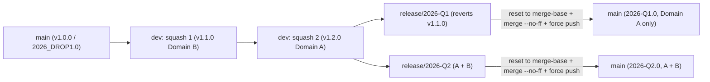

# VDAB Workshop `dbt` Release Flow Guide

## 1. Modified GitFlow Branching & Tagging Strategy

Repo: `http://localhost/workshop/dbt-vdp.git` from the host (`http://gitlab.local/workshop/dbt-vdp.git` inside
`workshop_net`, e.g. from CI jobs and the manager). Source: `/home/jim/Documents/dbt-workshop/dbt-singlestore-workshop`,
pushed as-is by `infrastructure/workshop.sh bootstrap` / `reset` (fresh history, `-o ci.skip`). Airflow UIs: LDV
`http://localhost:8088`, PRD `http://localhost:8090` (containers `workshop-airflow-dev` / `workshop-airflow-prod`).



### Rules
1. **Two permanent branches**
   - `dev`: integration (`DBT_DEPLOY_TARGET=LDV`, reads `analytics_dev`). Merge level 30, push level 40, no force push.
   - `main`: production (`CBT`/`PRD`, reads `analytics_prod`). Maintainers (40) only, `allow_force_push=true`.
2. **Features/bugfixes**: branch from `dev`, rebase, **squash-merge** into `dev` (project `squash_option="always"`). Each push to `dev` runs `tag_dev` (semver bump: minor for `feature/`/`feat*` commits, else patch) and `publish_dev_artifacts` syncs LDV.
3. **Release branches `release/YYYY-Qx`**: created from `dev`; protected (`release/*`, Maintainers, force push allowed). Features not approved, or whose source data is not delivered in PRD, are **reverted on the release branch only** (never on `dev`).
4. **Promotion to `main`** (always this sequence, so features reverted in an earlier release can rejoin a later one):
   ```bash
   git checkout -B main origin/main
   git reset --hard $(git merge-base main release/YYYY-Qx)
   git merge --no-ff release/YYYY-Qx -m "Merge branch 'release/YYYY-Qx' into 'main'"
   git push --force origin main
   ```
   The manual CI job `promote_release_to_main` does this; if HEAD equals the release tip after the reset it makes an `--allow-empty` merge commit so `tag_main` still tags `YYYY-Qx.0`.

## 2. Domain A vs. Domain B Collision Scenario

### Start state after `workshop.sh reset` (or bootstrap)
| Env | Landing DB | Watermark | Domain A payments | Domain B reviews | Deployed ref |
| :-- | :-- | :-- | :-- | :-- | :-- |
| LDV | `analytics_dev` | 2017-03-01 + 90d = 2017-05-30 | populated | populated | `dev` @ `v1.0.0` |
| CBT/PRD | `analytics_prod` | 2017-03-01 + 90d = 2017-05-30 | populated | **empty (withheld)** | `main` @ `2026_DROP1.0` |

GitLab starts with only `main`, `dev` (same commit, tags `v1.0.0` and `2026_DROP1.0`) and the orphan `changelog`
branch. The studio Reset returns to exactly this (milestone `baseline` + branches/tags + redeploy).

### Branch content (studio patch sets, `infrastructure/workshop-studio/patches/`)
Participants (or the studio, scenarios H0/E1) create the Domain branches from these patch sets
(`gitlab_commit_patch` commits the files of `<patch>/`, `_patch.yaml` holds metadata and find/replace `ops:`):
- **Baseline (`main`, `v1.0.0`)**: `sources_olist.yml` (source DB switches on `DBT_DEPLOY_TARGET`), `stg_olist_customers`,
  `stg_olist_orders`, `dim_olist_customers`, central `fct_olist_orders` (no domain hkeys), the carrier/web feed models.
- **`feature-domain-b-reviews` -> squash `v1.1.0`**: `stg_olist_reviews` (`domain_b_hkey`), `dim_olist_reviews`,
  `mart_olist_customer_satisfaction`, `olist_domain_b.yml`, `tests/assert_domain_b_reviews_delivered.sql` (severity
  error; fails while PRD reviews are empty) and `domain_b_hkey` in `fct_olist_orders`.
- **`feature-domain-a-payments` -> squash `v1.2.0`**: `stg_olist_payments` (`domain_a_hkey`), `dim_olist_payments`,
  `mart_olist_payment_performance`, `olist_domain_a.yml`; `domain_a_hkey` is inserted into `fct_olist_orders` by an
  `ops:` find/replace, so on a clean `dev` it adds only its own column and on top of B it lands on the adjacent line ->
  guaranteed conflict when reverting squash 1.
- **`resolve-release-domain-a-only`**: the resolved `fct_olist_orders.sql` (A kept, B dropped) for the revert.
- Other sets: `bug-finance-fanout` / `fix-finance-grain` (C1), `fix-reviews-dedup` (S3), `fix-webapp-contract-v2` (S2),
  `fix-carrier-timeline` (E6), `fix-web-customer-key` (S7), `fix-web-staging-contract` (E7), `fix-web-journeys` (E8).

### `release/2026-Q1` (exclude Domain B)
```bash
git checkout -b release/2026-Q1 origin/dev && git push -u origin release/2026-Q1
# verify_release_branch (CBT) FAILS on assert_domain_b_reviews_delivered
git revert --no-edit v1.1.0     # deletes 5 Domain B files, 3-hunk conflict in fct_olist_orders.sql
# resolve: keep domain_a_payments / a.domain_a_hkey, drop domain_b (= patches/resolve-release-domain-a-only)
cp <workshop>/infrastructure/workshop-studio/patches/resolve-release-domain-a-only/models/im_dimensional/fct_olist_orders.sql \
   models/im_dimensional/fct_olist_orders.sql
git add models/im_dimensional/fct_olist_orders.sql && git revert --continue
git push origin release/2026-Q1  # verify passes
```
Then promote to `main` (section 1, rule 4) -> `tag_main` creates `2026-Q1.0`; `publish_main_artifacts` deploys it as CBT (into the PRD workspace volume - CBT and PRD share it here); `deploy_prd_manual` (manual) deploys PRD; then trigger `dbt_release` in PRD.

### `release/2026-Q2` (Domain B delivered)
```bash
infrastructure/workshop.sh reset --trickle-prod 14 --enable-domain-b
git checkout -b release/2026-Q2 origin/dev && git push -u origin release/2026-Q2
```
Verification passes; promotion resets `main` to merge-base (past Q1's revert) so A and B both land in `2026-Q2.0`.

## 3. GitLab CI (`dbt-singlestore-workshop/.gitlab-ci.yml`)
Stages: `verify`, `promote`, `tag`, `build_and_publish`, `deploy`, `changelog`.

| Job | Trigger | Target | Action |
| :-- | :-- | :-- | :-- |
| `verify_feature_to_dev` | MR -> `dev` | LDV | compile `origin/dev` as state, merge, `build --select state:modified+ --state artifacts --defer --target=ci` (schema = branch name), `drop_nodes` (also in `after_script`) |
| `verify_release_branch` | push/MR on `release/YYYY-Qx` | CBT | full `build --target=ci --fail-fast`, `drop_nodes` |
| `verify_release_to_main` | MR -> `main` | CBT | full `build --target=ci --fail-fast` |
| `promote_release_to_main` | manual on release branch | - | merge-base reset, `--no-ff` merge, force push |
| `tag_dev` / `tag_main` | push `dev` / `main` | - | `vX.Y.Z` / `YYYY-Qx.N` tags |
| `publish_dev_artifacts` | tag `vX.Y.Z` | LDV | `.deploy-airflow` with `DEPLOY_TAG=$CI_COMMIT_TAG` |
| `publish_main_artifacts` | tag `YYYY-Qx.N` / `YYYY_DROPn.N` | CBT | `.deploy-airflow` |
| `deploy_abt_scheduled` | pipeline schedule | ABT | `.deploy-airflow` of the latest dev tag |
| `deploy_cbt_manual` / `deploy_prd_manual` | manual on `main` | CBT / PRD | `.deploy-airflow` of the latest release tag |
| `changelog` | any tag | - | update `CHANGELOG.md` on `changelog` branch |

`.deploy-airflow`: `git checkout $DEPLOY_TAG`, `dbt deps`, `dbt compile --target run --target-path artifacts`,
`dbt docs generate --target run --output-dir target/dbt-docs` (Fusion: a full static site, no `--static`), then rsync
into `/workshop_state/<dev|prod>` (`LDV|ABT` -> `workshop_dev`, `CBT|PRD` -> `workshop_prod`: the runner mounts both
volumes into every job): `airflow/dags/` -> `dags/`, `airflow/utils/` -> `dags/utils/`, the project -> `dbt/`,
`artifacts/` -> `mnt_dbt/{target,artifacts}`, the docs site -> `docs/` (served on 8081 / 8082).

Gotchas: `--vars` must be passed as `"SCHEMA: name"` (YAML, no extra quoting); `drop_nodes` only drops model/seed/snapshot relations via `adapter.execute`.

## 4. Airflow `dbt_release` DAG (`airflow/dags/dbt_release.py`)
```
audit_environment_drift >> pause_daily_load >> run_operation__database_maintenance
  >> prep_upstream__<step1> >> step1 >> merge_state__step1 >> ...
  >> reload step (TriggerDagRunOperator -> dbt_reload) >> merge_state__...
  >> build_remaining (--state accumulated_state --exclude 'tag:on-demand result:success')
  >> [cleanup_temporary_artifacts, unpause_daily_load]
```
- **Drift gate first**: `dbt run-operation audit_environment_drift --target run` fails the release on a relation changed/created outside dbt or a missing service-account grant, before anything is paused or built (dry-run: report only). See the architecture skill §4c and studio scenario E10.
- Pauses `dbt_daily_load`, `dbt_vdp`, `dbt_vdp_new`; fails loudly if the pause fails. `unpause_daily_load` uses `all_done`; `cleanup_temporary_artifacts` (`none_failed_min_one_success`) runs in parallel so failed runs are not marked SUCCESS and `accumulated_state` is kept.
- Each step writes artifacts under `/mnt/dbt/artifacts/release/<safe_run_id>/<task_id>`; `merge_state__*` merges them into `accumulated_state` so later steps/`build_remaining` skip already-succeeded nodes.
- `defer_to_reload: True` steps trigger `dbt_reload` (`deferrable=True`, `poke_interval=5`); see the `dbt-reload-pipeline` skill.
- `dry_run=true` logs planned commands without pausing or executing.
- Edit `RELEASE_STEPS` to change the sequence and redeploy.

## 5. Reset & Trickle Commands
```bash
cd /home/jim/Documents/dbt-workshop     # all of these run in the manager container (no host Python)
infrastructure/workshop.sh reset                                   # full reset (SingleStore, GitLab, LDV+PRD sync, milestone 'baseline')
infrastructure/workshop.sh reset --trickle-dev 14                  # +14d dev (A+B)
infrastructure/workshop.sh reset --trickle-prod 14                 # +14d prod (B withheld)
infrastructure/workshop.sh reset --trickle-prod 14 --enable-domain-b  # late Domain B delivery
infrastructure/workshop.sh milestone restore baseline              # warehouse only, ~15 s (what the studio Reset does first)
```
Airflow alternative: trigger `ifw_olist_trickle` (params `days_step`, `enable_domain_b_reviews`, `reset_landing`); it emits dataset `singlestore://olist/raw_olist_orders` for `dbt_daily_load`.

## 6. Workshop Studio (interactive scenarios on top of this flow)
`infrastructure/workshop-studio/` (container `workshop-studio`, `http://127.0.0.1:8085`) drives this release flow from a map of source teams -> platform teams -> consumers. Sim mode animates it offline; Live mode runs the real actions. Read `infrastructure/workshop-studio/README.md` for the full reference.
- **Scenario YAML** (`infrastructure/workshop-studio/scenarios/*.yaml`, loaded in natural order E1..E9, E10; nodes/edges/sprint in `world.yaml`): `inject` / `impact` / `steps`, each with a `sim:` block (map effects) and a `live:` block (actions). Live actions run first; a failure leaves the step pending.
- **Live action -> what it does here**: `set_channel`/`trickle` = `workshop.sh reset --channel ...`/`--trickle-*` (SQL on `analytics_{dev,prod}`); `sql` = a statement as root (`undo`, `ignore_errors`, `undo_ignore_errors`); `milestone` = `singlestore/milestones.sh`; `airflow_trigger` = `docker exec workshop-airflow-<env> airflow dags trigger`; `gitlab_branch` + `gitlab_commit_patch` + `gitlab_mr_merge` = feature branch from a patch set (`infrastructure/workshop-studio/patches/<name>/`), squash-merged to `dev` (so `tag_dev` bumps `v1.x.0`); `git_script revert_on_release` = section 2 (`git revert v1.1.0`, conflict in `fct_olist_orders.sql` resolved with `patches/resolve-release-domain-a-only`); `git_script promote_release` = section 1 rule 4.
- **Collision (E1)** = Domain B patch (`v1.1.0`) then Domain A patch (`v1.2.0`, fct has both hkeys on adjacent lines) -> `release/2026-Q1` -> `verify_release_branch` red -> revert B -> promote -> `2026-Q1.0` -> Q2 with `--enable-domain-b` -> `2026-Q2.0` (A+B). Reset (`workshop.sh reset`, or the studio Reset button) between live runs. The Domain A patch is an insert (`ops:` find/replace), so on a clean `dev` (H0) it adds only `domain_a_hkey`, and on top of B (E1) it lands on the adjacent line.
- **Starting state**: each live scenario's `requires:` (read-only `check_*` actions) is checked before its injection runs - H0/E1 need GitLab at the baseline (E1 also no PRD reviews), C1 needs Domain A in `dev`, S3 needs Domain B in `dev` without the dedup fix. A failed check returns HTTP 412 with what to do; nothing ran. Long live steps can be stopped with Cancel (`POST /api/cancel`).
- **Studio API from a shell**: state-changing calls need `-H 'X-Studio: 1'` (request guard against other browser pages). Clearing/replacing a scenario restores the nodes it touched and, in Live mode, resets the channel faults it set. A live Reset first restores the SingleStore milestone `baseline` (whole warehouse incl. model tables, run log, users/grants; fallback without it: channels + landing re-seeded), makes the probes ignore older dbt results / DAG runs, redeploys the baseline tags (`v1.0.0` -> LDV, `2026_DROP1.0` -> PRD) into the `workshop_dev` / `workshop_prod` volumes (`/workshop_state/<env>/{dags,dbt}`) via the GitLab archive API (a merged scenario fix that `tag_dev` published would otherwise stay live in LDV) and deletes the lever Variables. `dbt_daily_load` has a non-blocking `dbt_source_freshness` task.
- **Fault knobs** on the five channels (`webapp`, `kafka`, `drive`, plus the generated feeds `carrier` and `web`; `_source_channel_config` in `analytics_{dev,prod}`): `enabled`, `delay_batches`, `duplicate_pct`, `partial_pct`, `null_key_pct`, `schema_variant`, `late_pct` (carrier), `bot_events` (web). `workshop.sh reset --show-channels` prints config + `_delivery_log`; `--reset-channels` makes them healthy. `sp_trickle_olist_batch` keeps its signature.
- **Phase-2 scenarios** (S5-S7, E5-E9) use the generated feeds and the levers: `airflow_variable` sets/deletes `disabled_dbt_models` (exclude, lineage kept), `dbt_daily_load_dbtignore` (files leave the project) and `dbt_env_vars` (model version / severity switches) in `workshop-airflow-<env>`; clear and Reset delete them. S5/S6 run on PRD (no GitLab), E5 on LDV + PRD, E6/S7/E7/E8 fix through a bugfix branch on `dev` (`patches/fix-carrier-timeline`, `fix-web-customer-key`, `fix-web-staging-contract`, `fix-web-journeys`). Order without Reset: S5 -> S6 -> E5 -> E6 -> S7 -> E7 -> E8.
- **E10 (OPS-01, PRD, no GitLab)**: root hotfix on `im_dimensional.fct_olist_orders` (+ hand-made view) -> PRD daily load warns (report-only drift audit) and erases it -> view dropped -> `svc_prd_dbt` hardened by hand (`role_svc_prd`/`grp_svc_prd`, no DROP/ALTER on `im_dimensional`) -> `dbt_release` stops at the drift gate (`airflow.release` fail) -> grants restored, PRD daily load green. `sql` actions use `undo` + `undo_ignore_errors` (1917/1918/1919) so Clear is idempotent; Reset (milestone) also restores the account.
